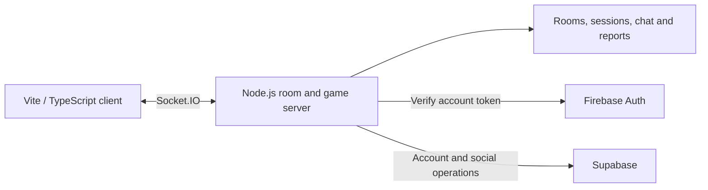

# Architecture

The deployment guide describes a static Vercel frontend and one Render backend process. Firebase and Supabase are optional for guest play. Provider settings are operator-managed. See [deployment](../DEPLOYMENT.md).

| Layer | Responsibility |
| --- | --- |
| [Client application](../client/src/main.ts) and [views](../client/src/views.ts) | Collect intent, send actions, handle acknowledgments and live updates, render state for this viewer. |
| [Socket entry](../server/server.js) and [room handlers](../server/roomHandlers.js) | Establish identity, validate requests, route actions and publish updates. |
| [Room manager](../server/roomManager.js) | Own room membership, host, lobby configuration, revisions, discovery and finished-match viewers. |
| [Registry](../server/gameRegistry.js) and [library](../server/gameLibrary.js) | Validate playable engine hooks and metadata, then project availability and selection rights for the requesting account. |
| [Protocols](../server/gameProtocols.js) and [game manager](../server/gameManager.js) | Bind game event families and dispatch session lifecycle and actions to the selected engine. The two Fact or Cap variants share a protocol. |

## From room creation to results

Creating a room establishes the host and room code. Public discovery projects a separate listing ID, host name, selected game, occupancy and status. Private, locked, full and active rooms are excluded. The server checks admission again at join time. The host configures the lobby and starts a session after readiness checks.

Each engine owns its prompts, round phases, submissions, votes and scores. Public projections expose the information permitted in the current phase. Viewer-specific state supplies details such as the player's own submission or eligible voting options. Send projections through the appropriate game protocol. Raw session state can reveal answers or authors prematurely. Consult the [event contracts](../server/ROOM_PROTOCOL.md) and the mechanics guides for [Fact or Cap](../server/games/fact-or-cap/README.md) and [Bruh wtf?](../server/games/bruh-wtf/README.md).

On completion, the room tracks archived results by session and viewer so one player can still view results after the host returns to the lobby. Viewer departure releases the archive when its last viewer leaves. Room destruction ends its remaining room-scoped state.

## Identity and recovery

A socket identifies one connection. The server issues a stable guest player identity and recovery credential. The [browser guest session](../client/src/guestSession.ts) keeps recovery data in tab-scoped session storage. A separate Firebase token, when provided and verified, identifies the account used for privileged and social actions.

Unexpected disconnect starts a 90-second seat reservation. During active play the disconnected player leaves the current action quorum. Recovery during that round preserves completed actions and score and restores the player as a spectator until the next question. A final-round spectator can view results. Explicit leave and kick take effect immediately. The [restoration client](../client/src/sessionRestoration.ts) reconciles server snapshots with incoming live events.

## Storage and access boundaries

| Owner | State and lifetime |
| --- | --- |
| Room and game managers | Membership, room bans, sessions and archived results live in process memory. All disappear on process replacement. |
| [Chat](../server/roomChatManager.js) | Room-scoped message history, reactions and send limits live in memory. Members receive paged history. |
| [Moderation](../server/moderation.js) | A separate process-local queue holds reports and review decisions. Filing a report creates a review item. Review access requires a verified account UID in the server moderator allowlist. |
| Game library | Default grant store lives in memory. |
| [Account repository](../server/profileRepository.js) and [migrations](../supabase/migrations) | Configured Supabase storage holds profiles, social relationships, notifications and game invitations independently of the room process. |

Independent backend instances have independent rooms, discovery and recovery maps. A browser credential alone cannot reconstruct server state. See [known issues](KNOWN_ISSUES.md).
